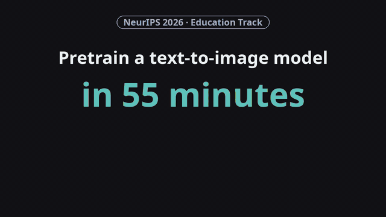

<p align="center"></p>

<p align="center">
  <a href="https://neurips.cc/" target="_blank"></a>
  <a href="https://arxiv.org/abs/2610.18870" target="_blank"></a>
  <a href="https://reyhaneesmailizadeh.github.io/MiniDog/" target="_blank"></a>
  <a href="https://huggingface.co/datasets/reyhanehesi/minidog-data" target="_blank"></a>
  <a href="https://huggingface.co/reyhanehesi/minidog-checkpoints" target="_blank"></a>
</p>

<p align="center">
  <a href="assets/minidog-video.mp4"></a>
</p>
<p align="center"><sub><a href="assets/minidog-video.mp4">Full 44-second video</a></sub></p>

**MiniDog** pretrains a 22M-parameter text-to-image diffusion transformer in **55 minutes** and fine-tunes
it in another **15 minutes** on four RTX 3090 GPUs. It is a minimal, open resource for learning
text-to-image flow matching end to end: data, architecture, training, and evaluation, from pretraining
to fine-tuning. MiniDog is teaching material accepted to the **NeurIPS 2026 Education Track**.

| Stage | Data | Time on 4× RTX 3090 | Result |
|---|---|---|---|
| Pretraining, 200 epochs | 26k recaptioned ImageNet dog photos, 20 breeds | 55 min | FID 8.32 |
| Fine-tuning, 100 epochs | 2k FLUX.1-schnell images of the same breeds | 15 min | HPSv2 0.1625 → 0.2427, PickScore 18.42 → 19.61 |

The recipe: a 12-block LightningDiT on frozen E2E-INVAE latents, conditioned in context on Qwen3-0.6B
embeddings of 128-token captions, and pretrained with iREPA alignment to EUPE ViT-B/16 features at
block 4. Image and text features are computed once and cached, so training only updates the
transformer.


## Quickstart

> [!NOTE]
> **Installation and data.** Clone the code, install it with [uv](https://docs.astral.sh/uv/), and
> download the datasets and the EUPE encoder. You need Linux and NVIDIA GPUs with a driver that
> supports CUDA 12.8; the paper uses four 24 GB RTX 3090s. Plan for about 50 GB of free disk: 20 GB
> for the data and cached features, 8 GB for the Python environment, and 20 GB of model and package
> caches under `~/.cache` (set `HF_HOME` and `UV_CACHE_DIR` to move them if your home directory is small).

```bash
git clone https://github.com/Reyhaneesmailizadeh/MiniDog && cd MiniDog
curl -LsSf https://astral.sh/uv/install.sh | sh   # skip if you already have uv
uv sync

export DATA=data/dog-t2i-diffusion-data
uv run hf download reyhanehesi/minidog-data --local-dir $DATA --repo-type dataset
for NAME in dogs_recaptioned_wds dogs_synthetic_2k_wds dogs_recaptioned_64tok_wds; do
  mkdir -p $DATA/$NAME && tar -xzf $DATA/$NAME.tar.gz -C $DATA/$NAME && rm $DATA/$NAME.tar.gz
done
uv run python -m minidog.fid_stats --data-dir $DATA/dogs_recaptioned_wds \
    --output $DATA/dogs_recaptioned_stats.npz

# EUPE ViT-B/16, the alignment target. Its weights are not downloaded automatically.
git clone https://github.com/facebookresearch/EUPE ../EUPE
uv run hf download facebook/EUPE-ViT-B EUPE-ViT-B.pt --local-dir ../eupe_ckpts
export EUPE_REPO_DIR=$(realpath ../EUPE) EUPE_CKPT_DIR=$(realpath ../eupe_ckpts)
```

Keep `DATA`, `EUPE_REPO_DIR` and `EUPE_CKPT_DIR` set in every new shell; the steps below use them.
Click a step to open it. The first runs print a few harmless warnings, such as `accelerate` not being
installed and the "unexpected keys" of EUPE's distillation heads, which MiniDog does not use.

`uv sync` installs Python 3.13 (pinned in `.python-version`). If training stops with
`fatal error: Python.h: No such file or directory`, your system Python lacks its development headers,
which `--compile` needs; run `uv sync --managed-python` to switch to uv's own Python, which has them.

<details open>
<summary><b>1. Pretrain the best recipe</b> &nbsp;·&nbsp; 55 minutes on 4 GPUs &nbsp;·&nbsp; FID 8.32</summary>
<br>

Cache the latents, text embeddings and EUPE features of the 26k photos once (a few minutes), then
pretrain for 200 epochs.

```bash
uv run torchrun --standalone --nproc_per_node=4 -m minidog.precompute_latents_eupe \
    --config configs/pretrain_e2e-invae_128tok_mse_irepa_eupe.yaml \
    --input-dir $DATA/dogs_recaptioned_wds \
    --output-dir $DATA/dogs_recaptioned_latents_e2e-invae_eupe

export EXPERIMENT_NAME=pretrain
uv run torchrun --standalone --nproc_per_node=4 -m minidog.train \
    --config configs/pretrain_e2e-invae_128tok_mse_irepa_eupe.yaml --compile
```

FID is evaluated during training every 5,000 steps and written to `results/evals/`; the value at
step 20,000 is the paper's FID. This in-training evaluation doubles the run time, and the 55 minutes
are measured without it (set `eval.eval_interval: 0` in the config to turn it off).

**Only one GPU?** Use `--nproc_per_node=1` in both `torchrun` commands and train with
`configs/pretrain_e2e-invae_128tok_mse_irepa_eupe_1gpu.yaml`. It accumulates gradients over four
micro-batches of 64 images, so each optimizer step still uses 256 images and training follows the
same schedule as on four GPUs. Without the in-training FID evaluation, training takes about 3 hours
on one RTX 3090. This config evaluates FID only once, at step 20,000, instead of every 5,000 steps.
</details>

<details>
<summary><b>2. Fine-tune the pretrained checkpoint</b> &nbsp;·&nbsp; 15 minutes on 4 GPUs</summary>
<br>

Cache the 2k synthetic images, then fine-tune for 100 epochs with the alignment loss off.

```bash
uv run torchrun --standalone --nproc_per_node=4 -m minidog.precompute_latents_eupe \
    --config configs/sft_e2e-invae_128tok_mse_norepa.yaml \
    --input-dir $DATA/dogs_synthetic_2k_wds \
    --output-dir $DATA/dogs_synthetic_2k_latents_e2e-invae_eupe

export EXPERIMENT_NAME=sft
uv run torchrun --standalone --nproc_per_node=4 -m minidog.train \
    --config configs/sft_e2e-invae_128tok_mse_norepa.yaml --compile \
    --ckpt ckpts/pretrain/checkpoints/ep-0000200.pt --init-weights-only
```

In-training FID evaluation adds about an hour here; set `eval.eval_interval: 0` to skip it.
</details>

<details>
<summary><b>3. Generate and score</b> &nbsp;·&nbsp; HPSv2 0.1625 → 0.2427, PickScore 18.42 → 19.61</summary>
<br>

Sample the 500 held-out prompts from both checkpoints with shared noise, then score them with
HPSv2 and PickScore.

```bash
for RUN in "pretrain configs/pretrain_e2e-invae_128tok_mse_irepa_eupe.yaml" \
           "sft configs/sft_e2e-invae_128tok_mse_norepa.yaml"; do
  set -- $RUN
  uv run python -m minidog.generate --config $2 \
      --checkpoint $(ls ckpts/$1/checkpoints/*.pt | tail -1) \
      --captions-json $DATA/captions_500.json --output-dir results/samples/$1 \
      --noise-file results/samples/shared_noise_500.pt --group-by-breed
done
uv run python -m minidog.score_absolute --dirs results/samples/pretrain results/samples/sft
```

`--noise-file` reuses the same 500 noise tensors for both checkpoints, so each pair of images differs
only by the checkpoint.
</details>

<details>
<summary><b>No training: score the released checkpoints</b></summary>
<br>

After the installation step, download the two checkpoints and generate and score with them:

```bash
uv run hf download reyhanehesi/minidog-checkpoints --local-dir ckpts/released
for RUN in "pretrain configs/pretrain_e2e-invae_128tok_mse_irepa_eupe.yaml irepa-eupe-mse-ep200.pt" \
           "sft configs/sft_e2e-invae_128tok_mse_norepa.yaml sft-eupe-norepa-ep100.pt"; do
  set -- $RUN
  uv run python -m minidog.generate --config $2 --checkpoint ckpts/released/$3 \
      --captions-json $DATA/captions_500.json --output-dir results/samples/$1 \
      --noise-file results/samples/shared_noise_500.pt --group-by-breed
done
uv run python -m minidog.score_absolute --dirs results/samples/pretrain results/samples/sft
```
</details>

## Reproduce the comparisons

Each comparison in the paper changes one setting of the final recipe and keeps the rest fixed. Train
a config exactly like step 1 of the quickstart, after caching the features it reads (see the dropdown below):

```bash
CONFIG=configs/pretrain_e2e-vavae_128tok_mse_irepa_eupe.yaml
export EXPERIMENT_NAME=$(basename $CONFIG .yaml)
uv run torchrun --standalone --nproc_per_node=4 -m minidog.train --config $CONFIG --compile
```

| In the paper | Changed setting | Config | FID at 20k steps |
|---|---|---|---|
| Fig. 3, Table 2 | none (the final recipe) | `pretrain_e2e-invae_128tok_mse_irepa_eupe.yaml` | **8.32** |
| Fig. 3 | E2E-VAVAE instead of E2E-INVAE | `pretrain_e2e-vavae_128tok_mse_irepa_eupe.yaml` | 12.23 |
| Table 2 | 64-token instead of 128-token captions | `pretrain_e2e-invae_64tok_mse_irepa_eupe.yaml` | 8.54 |
| Fig. 4 | REPA instead of iREPA | `pretrain_e2e-invae_128tok_mse_repa_eupe.yaml` | 9.71 |
| Fig. 4 | no alignment | `pretrain_e2e-invae_128tok_mse_norepa.yaml` | 11.47 |
| Table 3 | target representation, REPA or iREPA, squared error or cosine | `pretrain_e2e-invae_128tok_{mse,cosine}_{repa,irepa}_{dinov2,dinov3,pe-spatial,eupe}.yaml` | all 16 in [`configs/README.md`](configs/README.md) |

Table 1 (tokenizer reconstruction: PSNR, SSIM, LPIPS and rFID on the 26k photos) needs no training:

```bash
uv run --with torchmetrics --with lpips python -m minidog.recon_eval --vae-type e2e-invae   # 28.42 dB, 0.792, 0.039, 1.14
uv run --with torchmetrics --with lpips python -m minidog.recon_eval --vae-type e2e-vavae   # 27.59 dB, 0.753, 0.044, 1.39
```

<details>
<summary><b>Cache the features each comparison reads</b></summary>

Each config reads the latents folder named in its `dataset.data_dir`. The final recipe's folder from
the quickstart already covers the EUPE runs at 128 tokens with E2E-INVAE.

```bash
EUPE="uv run torchrun --standalone --nproc_per_node=4 -m minidog.precompute_latents_eupe"

# E2E-VAVAE tokenizer (Fig. 3)
$EUPE --config configs/pretrain_e2e-vavae_128tok_mse_irepa_eupe.yaml \
    --input-dir $DATA/dogs_recaptioned_wds --output-dir $DATA/dogs_recaptioned_latents_e2e-vavae_eupe

# 64-token captions (Table 2)
$EUPE --config configs/pretrain_e2e-invae_64tok_mse_irepa_eupe.yaml \
    --input-dir $DATA/dogs_recaptioned_64tok_wds --output-dir $DATA/dogs_recaptioned_64tok_latents_e2e-invae_eupe

# DINOv2 features; the no-alignment run (Fig. 4) reads this folder too
uv run torchrun --standalone --nproc_per_node=4 -m minidog.precompute_latents \
    --config configs/pretrain_e2e-invae_128tok_mse_repa_dinov2.yaml \
    --input-dir $DATA/dogs_recaptioned_wds --output-dir $DATA/dogs_recaptioned_latents_e2e-invae

# DINOv3 features (Table 3). The model is gated: accept its license on Hugging Face, then `uv run hf auth login`.
uv run torchrun --standalone --nproc_per_node=4 -m minidog.precompute_latents_dinov3 \
    --config configs/pretrain_e2e-invae_128tok_mse_repa_dinov3.yaml \
    --input-dir $DATA/dogs_recaptioned_wds --output-dir $DATA/dogs_recaptioned_latents_e2e-invae_dinov3

# PE-Spatial features (Table 3)
uv run torchrun --standalone --nproc_per_node=4 -m minidog.precompute_latents_pe_spatial \
    --config configs/pretrain_e2e-invae_128tok_mse_repa_pe-spatial.yaml \
    --input-dir $DATA/dogs_recaptioned_wds --output-dir $DATA/dogs_recaptioned_latents_e2e-invae_pe_spatial
```

`norepa` configs reuse the folder of a sibling with the same tokenizer and caption length. The extra
configs that are not in the paper, and every path, are listed in [`configs/README.md`](configs/README.md).
</details>

## More

<details>
<summary><b>Tips: fewer GPUs, logging, resuming, CFG sweeps</b></summary>

- **Fewer or more GPUs.** Set `--nproc_per_node` to your GPU count. The global batch of 256 is split
  across the GPUs; if memory runs out, raise `training.grad_accum_steps` in the config.
- **Outputs.** Checkpoints and sample grids go to `ckpts/$EXPERIMENT_NAME/`, FID and IS to `results/evals/`.
- **Resuming.** Re-running with the same `EXPERIMENT_NAME` resumes from the latest checkpoint.
- **Weights & Biases.** Add `--wandb` and set `ENTITY`, `PROJECT` and `WANDB_KEY`.
- **Score one checkpoint, or sweep the CFG scale:**

  ```bash
  uv run torchrun --standalone --nproc_per_node=4 -m minidog.offline_eval --config <cfg> --checkpoint <ckpt> --cfg-scale 1.5 2.0 6.0
  ```

- **Pairwise comparison.** `minidog.score` compares two sample folders and prints the PickScore win rate
  and HPSv2 means, per breed and overall.
</details>

<details>
<summary><b>Hardware and software used in the paper</b></summary>

All runs use 4 of the 8 NVIDIA RTX 3090 GPUs (24 GB, 350 W) in a single server, connected over PCIe 4.0
without NVLink, with two AMD EPYC 7343 CPUs (32 cores in total), 256 GB of RAM, and the cached inputs on
a local NVMe SSD. The software stack is Ubuntu 24.04, NVIDIA driver 590.44, Python 3.13, PyTorch 2.10.0
with CUDA 12.8, cuDNN 9.10, NCCL 2.27, and Triton 3.6; `pyproject.toml` and `uv.lock` pin every package
version. Training uses PyTorch DistributedDataParallel over the 4 GPUs (64 images per GPU). Every
hyperparameter is in the paper's appendix and in the two configs of the final recipe.
</details>

<details>
<summary><b>Warm-up: flow matching on 2D toy data (CPU, about 15 minutes)</b></summary>

```bash
uv sync
uv run jupyter lab toy_flow_matching.ipynb
```

Run [the notebook](toy_flow_matching.ipynb) top to bottom; each cell is explained in the markdown above
it. You will learn how a flow-matching model is trained and sampled, and why predicting the clean data
beats predicting the velocity when the data lives in a high-dimensional space, while MiniDog can still
use v-prediction in its compressed latent space.
</details>

<details>
<summary><b>Where each concept lives in the code</b></summary>

| Flow-matching concept | Warm-up: [`toy_flow_matching.ipynb`](toy_flow_matching.ipynb) | Pipeline: [`minidog/`](minidog/) |
|---|---|---|
| Forward process `x_t = (1-t) x + t eps` | *Flow matching* cell, `training_losses` | [`Transport.sample`](minidog/transport.py#L103) |
| Target `v = eps - x`, MSE loss | same cell | [`compute_loss`](minidog/transport.py#L156) |
| x- vs v-prediction | `pred_type` branches | [`convert_model_pred`](minidog/transport.py#L149), config [`transport.prediction`](configs/pretrain_e2e-invae_128tok_mse_irepa_eupe.yaml#L28) |
| Timestep sampling during training | uniform `t` | [`get_time_sampler`](minidog/transport.py#L79), logit-normal |
| Euler sampling from noise to data | `sample` | [`Sampler.sample_ode`](minidog/transport.py#L176) |
| Time conditioning of the network | *Model* cell, `SinusoidalEmbedding` | [`GaussianFourierEmbedding`](minidog/dit.py#L86), 4 time tokens |
| The denoiser | `MLPDenoiser` | [`LightningDiT`](minidog/dit.py#L140) |
| Conditioning on text | — | [`TextEncoder`](minidog/text_encoder.py#L8), [`ConditionEmbedder`](minidog/dit.py#L104) |
| Classifier-free guidance | — | [`apply_cfg_dropout`](minidog/transport.py#L15) (train), [`forward_with_cfg`](minidog/transport.py#L200) (sample) |
| Flow matching in a latent space | — | [`VAE.encode`](minidog/vae.py#L153), [`precompute_latents`](minidog/precompute_latents.py#L180) |
| Representation alignment (REPA) | — | [`DINOv2Encoder`](minidog/dinov2.py#L9), [`repa_projector`](minidog/dit.py#L184), [`loss_repa`](minidog/transport.py#L144) |
| Target representation and iREPA | — | [`EUPEEncoder`](minidog/eupe.py), [`DINOv3Encoder`](minidog/dinov3.py), [`PESpatialEncoder`](minidog/pe_spatial.py); conv projector and spatial norm in [`dit.py`](minidog/dit.py#L184), [`transport.py`](minidog/transport.py#L131) |
</details>

<details>
<summary><b>Configs</b></summary>

One yaml per experiment, named `{stage}_{tokenizer}_{caption length}_{loss}_{alignment}_{target}.yaml`,
for example `pretrain_e2e-invae_128tok_mse_irepa_eupe.yaml` for the final recipe.
[`configs/README.md`](configs/README.md) explains every field and lists each config with its result.
</details>

<details>
<summary><b>Going further</b></summary>

- Set [`transport.prediction`](configs/pretrain_e2e-invae_128tok_mse_irepa_eupe.yaml#L28) to `x` and compare FID curves: the warm-up question at full scale.
- Turn [`repa.use_repa`](configs/pretrain_e2e-invae_128tok_mse_irepa_eupe.yaml#L86) off, change `repa.repa_layer_depth`, or swap the target representation.
- Try another tokenizer: add a class with `encode`/`decode` to [`minidog/vae.py`](minidog/vae.py) and point [`stage_1.target`](configs/pretrain_e2e-invae_128tok_mse_irepa_eupe.yaml#L2) at it, e.g. the [FLUX.2](https://huggingface.co/black-forest-labs/FLUX.2-dev) VAE or [RAEv2](https://github.com/nanovisionx/RAEv2).
- Sweep [`guidance.cfg.scale`](configs/pretrain_e2e-invae_128tok_mse_irepa_eupe.yaml#L36) on a checkpoint with `minidog.offline_eval`.
- Fine-tune on your own images: pack `jpg` + `txt` WebDataset shards, build FID stats with `minidog.fid_stats`, cache them with the SFT config, and train from the pretrained checkpoint.
</details>

<details>
<summary><b>Repository layout</b></summary>

| | Files | What |
|---|---|---|
| Model and objective | [`dit.py`](minidog/dit.py), [`transport.py`](minidog/transport.py) | LightningDiT; flow matching, Euler sampler, CFG |
| Frozen components | [`vae.py`](minidog/vae.py), [`text_encoder.py`](minidog/text_encoder.py), [`eupe.py`](minidog/eupe.py), [`dinov2.py`](minidog/dinov2.py), [`dinov3.py`](minidog/dinov3.py), [`pe_spatial.py`](minidog/pe_spatial.py) | tokenizer, Qwen3 captions, the four target representations |
| Training | [`engine.py`](minidog/engine.py), [`data.py`](minidog/data.py), [`eval.py`](minidog/eval.py), [`config.py`](minidog/config.py) | epoch loop, loaders, FID/IS, config dataclasses |
| Entry points | [`precompute_latents`](minidog/precompute_latents.py) (and `_eupe`, `_dinov3`, `_pe_spatial`), [`fid_stats`](minidog/fid_stats.py), [`train`](minidog/train.py), [`offline_eval`](minidog/offline_eval.py), [`generate`](minidog/generate.py), [`score_absolute`](minidog/score_absolute.py), [`score`](minidog/score.py), [`recon_eval`](minidog/recon_eval.py) | `python -m minidog.<name>` |
| Utilities | [`utils/`](minidog/utils/) | checkpoints, distributed, optimizer, resume, W&B |
| Other | [`configs/`](configs/), [`toy_flow_matching.ipynb`](toy_flow_matching.ipynb), [`docs/`](docs/) | experiment configs, the warm-up, the project page |
</details>


## Training on a Mac (Apple silicon, 16 GB)

> [!NOTE]
> This is the `mac-m5` branch. It runs the best recipe on a Mac's GPU (PyTorch's MPS backend)
> within 16 GB of shared memory, with the same 256-image updates as the paper:
>
> - **Micro-batch 16 × 16 accumulation steps** instead of 64 × 4, so each update still averages 256 images.
> - **A shuffled feature cache with a 500-sample buffer.** The cached shards are sorted by breed;
>   `minidog.shuffle_cache` rewrites them once so every shard holds all 20 breeds, and a 500-sample
>   buffer then mixes the breeds as well as the paper's 5,000-sample buffer (measured: 11.1 breeds per
>   micro-batch of 16 against 10.2) for about 3 GB less RAM.
> - **Qwen3 and EUPE are not loaded during training** (`training.load_frozen_encoders: false`).
>   Their outputs are cached; the empty caption's embedding, which classifier-free guidance needs,
>   is saved next to the cache as `null_text.pt`.
> - **A checkpoint every 5 epochs, keeping the newest 2**, so you can stop the laptop and resume.
>
> Measured on a 16 GB M5 MacBook with the Mac config: the training process uses 5.3–5.8 GB of
> unified memory during training steps and at most 6.8 GB while a sample grid is drawn (grids are
> decoded two images at a time), and its data-loading worker another 0.7 GB, so about 6.5 GB in
> total and 7.5 GB at the peak. macOS and your open apps need the rest, so close what you can.
> The pretraining cache takes 18 GB (0.68 MB per image), and the shuffled copy needs another 18 GB
> until the original is deleted; with the data, the Python environment and the model caches, plan
> for about 45 GB of free disk during caching and 30 GB after.

<details open>
<summary><b>Steps on the Mac</b> &nbsp;·&nbsp; about 3–4 days of pretraining and 3 hours of fine-tuning on an M5</summary>
<br>

**Install and download.** `uv` installs Python 3.13 and the macOS build of PyTorch.

```bash
git clone -b mac-m5 https://github.com/Reyhaneesmailizadeh/minidog && cd minidog
curl -LsSf https://astral.sh/uv/install.sh | sh   # skip if you already have uv
uv sync

export DATA=data/dog-t2i-diffusion-data
uv run hf download reyhanehesi/dog-t2i-diffusion-data \
    captions_500.json dogs_recaptioned_wds.tar.gz dogs_synthetic_2k_wds.tar.gz --repo-type dataset --local-dir $DATA
for NAME in dogs_recaptioned_wds dogs_synthetic_2k_wds; do
  mkdir -p $DATA/$NAME && tar -xzf $DATA/$NAME.tar.gz -C $DATA/$NAME && rm $DATA/$NAME.tar.gz
done

git clone https://github.com/facebookresearch/EUPE ../EUPE
uv run hf download facebook/EUPE-ViT-B EUPE-ViT-B.pt --local-dir ../eupe_ckpts
export EUPE_REPO_DIR=$(realpath ../EUPE) EUPE_CKPT_DIR=$(realpath ../eupe_ckpts)
```

**1. Cache, shuffle and pretrain.** Run everything as a single process (`python -m`, not
`torchrun`) and without `--compile`. `caffeinate -i` keeps the Mac awake; stop with Ctrl-C at any
time and rerun the same command to resume from the newest checkpoint.

```bash
uv run python -m minidog.precompute_latents_eupe --batch-size 8 \
    --config configs/pretrain_e2e-invae_128tok_mse_irepa_eupe_mac.yaml \
    --input-dir $DATA/dogs_recaptioned_wds --output-dir $DATA/dogs_recaptioned_latents_e2e-invae_eupe
uv run python -m minidog.shuffle_cache --input-dir $DATA/dogs_recaptioned_latents_e2e-invae_eupe \
    --output-dir $DATA/dogs_recaptioned_latents_e2e-invae_eupe_shuffled
rm -r $DATA/dogs_recaptioned_latents_e2e-invae_eupe   # the shuffled copy replaces it (18 GB)

export EXPERIMENT_NAME=pretrain
caffeinate -i uv run python -m minidog.train --config configs/pretrain_e2e-invae_128tok_mse_irepa_eupe_mac.yaml
```

**2. Fine-tune.**

```bash
uv run python -m minidog.precompute_latents_eupe --batch-size 8 \
    --config configs/sft_e2e-invae_128tok_mse_norepa_mac.yaml \
    --input-dir $DATA/dogs_synthetic_2k_wds --output-dir $DATA/dogs_synthetic_2k_latents_e2e-invae_eupe
uv run python -m minidog.shuffle_cache --input-dir $DATA/dogs_synthetic_2k_latents_e2e-invae_eupe \
    --output-dir $DATA/dogs_synthetic_2k_latents_e2e-invae_eupe_shuffled

export EXPERIMENT_NAME=sft
caffeinate -i uv run python -m minidog.train --config configs/sft_e2e-invae_128tok_mse_norepa_mac.yaml \
    --ckpt ckpts/pretrain/checkpoints/ep-0000200.pt --init-weights-only
```

**3. Generate and score.** Both scripts pick the Mac's GPU automatically.

```bash
for RUN in "pretrain configs/pretrain_e2e-invae_128tok_mse_irepa_eupe_mac.yaml" \
           "sft configs/sft_e2e-invae_128tok_mse_norepa_mac.yaml"; do
  set -- $RUN
  uv run python -m minidog.generate --config $2 \
      --checkpoint $(ls ckpts/$1/checkpoints/*.pt | tail -1) \
      --captions-json $DATA/captions_500.json --output-dir results/samples/$1 \
      --noise-file results/samples/shared_noise_500.pt --group-by-breed
done
uv run python -m minidog.score_absolute --dirs results/samples/pretrain results/samples/sft
```

FID is not computed during training on this branch. To measure it afterwards (slow on a laptop),
build the reference statistics with `minidog.fid_stats` as in the Quickstart below, then run
`uv run python -m minidog.offline_eval --config configs/pretrain_e2e-invae_128tok_mse_irepa_eupe_mac.yaml --checkpoint ckpts/pretrain/checkpoints/ep-0000200.pt --batch-size 16`.

**How long it takes on an M5 (16 GB).** Measured on the M5 for caching and for the first training
steps; the totals are extrapolated from them.

| Step | Work | Time |
|---|---|---|
| Cache pretraining features | 26,000 images, about 1.5 s per batch of 8 | about 1.5 hours |
| Pretrain, 200 epochs | 101 updates per epoch, 13–16 s per update | about 3–4 days |
| Cache fine-tuning features | 2,000 images | about 10 minutes |
| Fine-tune, 100 epochs | 7 updates per epoch, 13–16 s per update | about 3 hours |

Each update is 16 micro-batches of 16 images. Updates took about 13 s at the start and about 16 s
after a few minutes of running, probably as the laptop warmed up. Each sample grid adds about
75 s; pretraining draws one every 1,000 updates, so 20 grids or about 25 minutes in all. Keep the
Mac plugged in, and stop and resume at any time with Ctrl-C.

**If something fails on the Mac.** `PYTORCH_ENABLE_MPS_FALLBACK=1` runs any operation MPS lacks on
the CPU. If bf16 is not supported on your macOS version, add `--precision fp32` to the training and
generation commands; the GPU part then grows to roughly 4 GB.

**What was tested.** On Linux: the whole non-CUDA path on the CPU (caching, shuffling, pretraining
with resume, fine-tuning, generation, and FID as one process), unchanged results on CUDA (the
released checkpoints give HPSv2 0.1624 → 0.2427 and PickScore 18.42 → 19.61 with the paper's noise;
the paper's 0.1625 differs only by rounding from decoding two images at a time). On a 16 GB M5
MacBook: caching on MPS, and 22 updates of bf16 pretraining on part of the cache, with checkpoints
and sample grids, plus the memory and times above. Not yet run on the Mac: a full pretraining or
fine-tuning run, generation, scoring and FID.
</details>


## Results of the Best Recipe on Mac M4

**Compute:** pre-training ~23 hrs + evaluation ~5 hrs

### Generation quality (Dogs, CFG = 6.0)

| Step  | FID ↓  | Inception Score ↑ |
|-------|--------|-------------------|
| 20200 | 8.9238 | 18.1195           |

### Fine-tuning comparison (500 samples each)

| Model        | HPSv2 ↑ | PickScore ↑ |
|--------------|---------|-------------|
| Pre-trained  | 0.1570  | 18.41       |
| SFT          | 0.2397  | 19.55       |
| **Δ (SFT − pre-trained)** | **+0.0827** | **+1.15** |

## Citation

```bibtex
@misc{esmailizadeh2026minidog,
  title         = {MiniDog: Dog-Breed Text-to-image Flow Matching from Pretraining
                   to Fine-Tuning on 4 Consumer GPUs},
  author        = {Esmailizadeh, Reyhaneh and Leng, Xingjian and Liang, Zhanhao and Zheng, Liang},
  year          = {2026},
  eprint        = {2610.18870},
  archivePrefix = {arXiv},
  primaryClass  = {cs.CV},
  url           = {https://arxiv.org/abs/2610.18870},
  note          = {NeurIPS 2026 Education Track}
}
```

## Acknowledgements

MiniDog adopts the [DiffusionBench](https://arxiv.org/abs/2606.24888) framework and builds on
[REPA](https://arxiv.org/abs/2410.06940), [iREPA](https://arxiv.org/abs/2512.10794),
[REPA-E](https://arxiv.org/abs/2504.10483) (E2E-INVAE and E2E-VAVAE),
[LightningDiT](https://arxiv.org/abs/2501.01423), [EUPE](https://arxiv.org/abs/2603.22387),
[Qwen3](https://arxiv.org/abs/2505.09388) and [FLUX.1-schnell](https://github.com/black-forest-labs/flux).
Released under the [MIT License](LICENSE).
